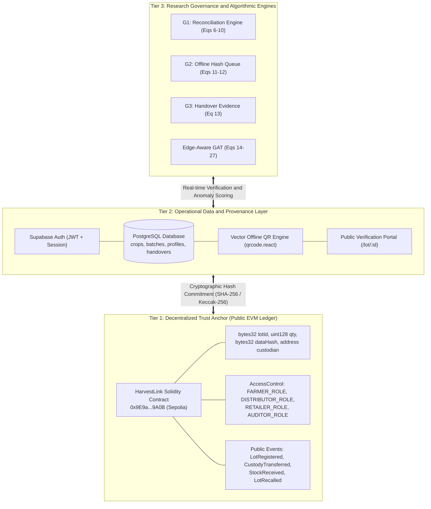
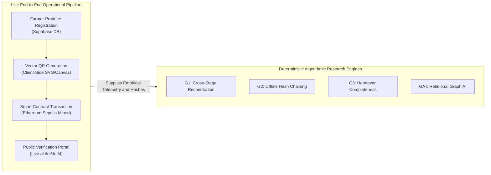
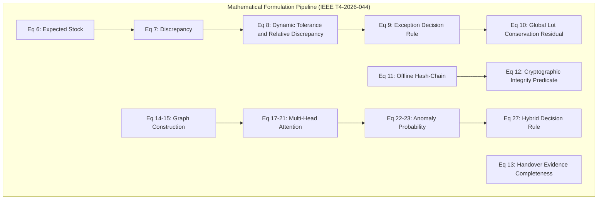
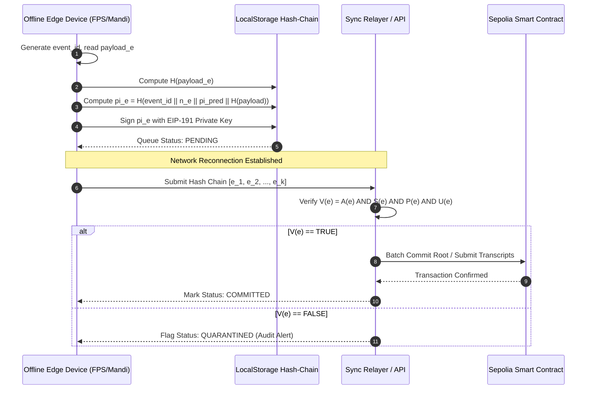

# HarvestLink: Cryptographic Verification &amp; Edge-Aware Graph Anomaly Detection for Food Supply Chains

> **Academic Reference:** IEEE Manuscript T4-2026-044  
> **Production Live Deployment:** [https://creative-bonbon-6a77a5.netlify.app](https://creative-bonbon-6a77a5.netlify.app)  
> **Smart Contract (Ethereum Sepolia):** [`0x9E9a23A7a549F569e36ae1594e5C1A34397d9A0B`](https://sepolia.etherscan.io/address/0x9E9a23A7a549F569e36ae1594e5C1A34397d9A0B)  
> **Target Jurisdiction:** National Public Distribution System (PDS) &amp; Targeted Public Distribution (TPDS)

---

## 1. Executive System Architecture

HarvestLink addresses systemic diversion, quantity skimming, phantom dispatching, and record tampering in large-scale food distribution networks. The architecture is organized into **three distinct tiers** to ensure high throughput, zero PII leakage, and mathematical auditability.



---

## 2. Live Operational Infrastructure vs. Research Workflows



### 2.1 Live Operational Services (100% Production Connected)

1. **Role-Based Access Control (RBAC):** Supabase Auth + PostgreSQL Row-Level Security (RLS) with `switch_active_role` RPC.
2. **Farmer Mandi Registration Pipeline:** Real crops and lot batches inserted into PostgreSQL with UUID primary keys.
3. **Decentralized Trust Anchor (Ethereum Sepolia):**
   - Contract: `0x9E9a23A7a549F569e36ae1594e5C1A34397d9A0B`
   - Confirmed tx: [`0x901bfbd0...531a9`](https://sepolia.etherscan.io/tx/0x901bfbd06143e1edf82eb8ba8d74deefd6dba19b66216aa7e3e24cffbbb531a9) — Block `12174749`
4. **Vector Offline QR Code System:** `qrcode.react` (`QRCodeSVG` + `QRCodeCanvas`), no third-party API.
5. **Universal Public Trace Portal (`/lot/:lotId`):** Netlify SPA redirects + hybrid Supabase + Etherscan verification.

---

## 3. Research Workflows &amp; Mathematical Formalization



### 3.1 Cross-Stage Quantity Reconciliation (G1)

Modeled in `src/lib/reconciliation.ts` after Section V-A.

For each facility $v$ during settlement period $t$, the **Expected Closing Stock** is:

$$S^{\text{exp}}_{v,t} = S^{\text{obs}}_{v,t-1} + I_{v,t} - O_{v,t} - B_{v,t} - L_{v,t} \qquad \textbf{(Eq. 6)}$$

Where $S^{\text{obs}}_{v,t-1}$ is the verified opening stock, $I_{v,t}$ is accepted inbound shipments, $O_{v,t}$ is authorized outbound dispatches, $B_{v,t}$ is beneficiary distributions, and $L_{v,t}$ is permitted transit loss.

The **Observed Discrepancy** is:

$$\Delta_{v,t} = S^{\text{exp}}_{v,t} - S^{\text{obs}}_{v,t} \qquad \textbf{(Eq. 7)}$$

The **Dynamic Tolerance** $\tau_{v,t}$ and **Relative Discrepancy** $z_{v,t}$ prevent false alarms from measurement jitter:

$$\tau_{v,t} = \max(\tau_{\text{abs}},\; \rho \cdot S^{\text{exp}}_{v,t}), \qquad z_{v,t} = \frac{|\Delta_{v,t}|}{\max(S^{\text{exp}}_{v,t},\; \epsilon)} \qquad \textbf{(Eq. 8)}$$

Where $\tau_{\text{abs}} = 10.0\,\text{kg}$, $\rho = 0.005$ (0.5% scale tolerance), and $\epsilon = 10^{-4}$.

The **Deterministic Exception Decision Rule** is:

$$a^{\text{rule}}_{v,t} = \mathbf{1}\left[ |\Delta_{v,t}| > \tau_{v,t} \right] \qquad \textbf{(Eq. 9)}$$

The **Lot Conservation Residual** $r_{l,t}$ across all facilities $\mathcal{V}$ prevents cross-facility leakage:

$$r_{l,t} = Q_l - \left( \sum_{v \in \mathcal{V}} S^{\text{obs},(l)}_{v,t} + \sum_{e \in \mathcal{T}_t} q^{\text{disp}}_e + B^{(l)}_{\le t} + L^{(l)}_{\le t} \right) \qquad \textbf{(Eq. 10)}$$

---

### 3.2 Offline-First Event Capture &amp; Hash Chaining (G2)

Modeled in `src/lib/offlineQueue.ts` after Section V-B.

When network connectivity is unavailable, local events are chained in a tamper-evident append-only structure:

$$\pi_e = H\!\left(\text{event\_id} \parallel n_e \parallel \pi_{\text{pred}(e)} \parallel H(\text{payload}_e)\right) \qquad \textbf{(Eq. 11)}$$

Where $n_e$ is the monotonically increasing device sequence number, $\pi_{\text{pred}(e)}$ is the hash of the preceding event ($\pi_0 = \text{"GENESIS"}$), and $H$ is Keccak-256 / SHA-256.

Upon reconnection, the **Cryptographic Integrity Predicate** $V(e)$ is validated:

$$V(e) = A(e) \land S(e) \land P(e) \land U(e) \qquad \textbf{(Eq. 12)}$$

Where $A(e)$ = actor authority check, $S(e)$ = EIP-191 signature verification over $\pi_e$, $P(e)$ = predecessor hash continuity ($\pi_{\text{pred}(e)} = \pi_{e-1}$), and $U(e)$ = idempotency (no duplicate `event_id`).



---

### 3.3 Handover Evidence Completeness (G3)

Modeled in `src/lib/evidence.ts` after Section V-C.

Physical-to-digital handovers are scored by the **Evidence Completeness Metric** $C_e \in [0,\, 1]$:

$$C_e = \frac{1}{m} \sum_{k=1}^{m} \mathbf{1}\left[ f_k \text{ is present and valid} \right] \qquad \textbf{(Eq. 13)}$$

The 12 verification dimensions evaluated ($m = 12$):

| # | Field | Description |
|:-:|:---|:---|
| 1 | `shipmentId` | Unique verifiable consignment code |
| 2 | `lotId` | Referenced parent/child commodity lot identifier |
| 3 | `senderAddress` | Validated sender wallet address |
| 4 | `receiverAddress` | Validated receiver wallet address |
| 5 | `vehicleCarrierRef` | Carrier registration or GPS fleet tracking tag |
| 6 | `sealId` | Tamper-evident mechanical/RFID bolt seal identifier |
| 7 | `dispatchQty` | Verified weighment at dispatch point |
| 8 | `receiptQty` | Independent weighment at receiving point |
| 9 | `weighmentSlipRef` | Calibrated weighbridge digital ticket hash |
| 10 | `inspectionPassed` | Independent quality inspection certification |
| 11 | `moisturePercentage` | Grain moisture content (ideal: $10\% \le M \le 14\%$) |
| 12 | `receiverSignature` | EIP-191 receiver acceptance cryptographic signature |

A transfer is flagged non-compliant if $C_e < 0.85$.

---

### 3.4 Edge-Aware Graph Attention Network (GAT) Anomaly Engine

Modeled in `src/lib/gatAnomalyEngine.ts` after Section VI.

The supply chain is modeled as a temporal directed multigraph:

$$\mathcal{G}_t = (\mathcal{V},\; \mathcal{E}_t,\; \mathbf{X}_t,\; \mathbf{Z}_t) \qquad \textbf{(Eq. 14)}$$

#### Edge Feature Representation

For each transfer edge $e = (i, j) \in \mathcal{E}_t$, the feature vector $\mathbf{z}_{ij}$ is:

$$\mathbf{z}_{ij} = \left[ d_{ij},\; r_{ij},\; l_{ij},\; C_e \right]^{\top} \qquad \textbf{(Eq. 15)}$$

Where:
- $d_{ij} = q^{\text{disp}}_{ij} - q^{\text{rec}}_{ij}$ — Absolute transit quantity gap
- $r_{ij} = d_{ij} / \max(q^{\text{disp}}_{ij},\; \epsilon)$ — Relative transit loss ratio
- $l_{ij}$ — Transit duration in hours
- $C_e$ — Evidence completeness score from Eq. 13

#### Edge-Aware Attention Mechanism

For node $i$ with neighborhood $\mathcal{N}_i$, the attention coefficient $\alpha_{ij}^{k}$ under head $k$ is:

$$\alpha_{ij}^{k} = \frac{\exp\left(\text{LeakyReLU}\!\left(\mathbf{a}_k^{\top}\left[\mathbf{W}_k\mathbf{x}_i \parallel \mathbf{W}_k\mathbf{x}_j \parallel \mathbf{W}_e^k\mathbf{z}_{ij}\right]\right)\right)}{\sum_{u \in \mathcal{N}_i} \exp\left(\text{LeakyReLU}\!\left(\mathbf{a}_k^{\top}\left[\mathbf{W}_k\mathbf{x}_i \parallel \mathbf{W}_k\mathbf{x}_u \parallel \mathbf{W}_e^k\mathbf{z}_{iu}\right]\right)\right)} \qquad \textbf{(Eq. 17)}$$

The transfer-level anomaly probability $p_{ij}$ aggregates multi-head representations:

$$p_{ij} = \sigma\!\left(\mathbf{w}_c^{\top}\left[\mathbf{h}_i \parallel \mathbf{h}_j \parallel \mathbf{z}_{ij}\right] + b_c\right) \qquad \textbf{(Eq. 23)}$$

#### The 8 Empirical Attack Families ($A_1$ to $A_8$)

| ID | Attack Family | Description |
|:--:|:---|:---|
| $A_1$ | **Phantom Dispatch** | Consignment created on ledger without physical grain allocation |
| $A_2$ | **En-Route Hijacking** | Physical carrier diverted; delivery unfulfilled |
| $A_3$ | **Quantity Skimming** | Systemic extraction of 2–5% grain during transit |
| $A_4$ | **Moisture Adulteration** | Dry grain replaced with high-moisture product to mask weight deficit |
| $A_5$ | **Seal Compromise** | Unbroken seal records with physical seal discrepancies |
| $A_6$ | **Recycled Delivery Slips** | Replaying historical weighbridge certificates for new shipments |
| $A_7$ | **Sub-Tolerance Skimming** | Distributed skimming below $\tau_{v,t}$ across many facilities |
| $A_8$ | **Collusive Laundering** | Paired entities falsifying transfer volumes to cover deficits |

#### Hybrid Decision Rule $\mathcal{D}(e)$

$$\mathcal{D}(e) = \begin{cases} \text{REJECT} & \text{if } C(e) = 0 \text{ or } a^{\text{rule}}_e = 1 \\ \text{REVIEW} & \text{if } C(e) = 1 \text{ and } a^{\text{rule}}_e = 0 \text{ and } p_{ij} \ge \theta^* \\ \text{ACCEPT} & \text{if } C(e) = 1 \text{ and } a^{\text{rule}}_e = 0 \text{ and } p_{ij} < \theta^* \end{cases} \qquad \textbf{(Eq. 27)}$$

Where $C(e) \in \{0, 1\}$ is smart contract constraint validity and $\theta^* = 0.55$ is the optimal decision threshold.

---

## 4. Algorithmic Workflows &amp; Execution Procedures

### Algorithm 1: Dual-Layer Lot Registration &amp; Verification

```text
Input:  Produce Lot Data D = {name, quantity, price, location, certifications, farmerWallet}
Output: Database UUID cropId, Batch Number batchNum, Transaction Hash txHash, Vector QR Code

 1: farmerProfileId <- Query profiles WHERE user_id == auth.currentUser.id
 2: IF farmerProfileId is NULL THEN
 3:     THROW Error("Unauthorized Farmer Profile")
 4: END IF

 5: // Step 1: Off-chain transactional persistence
 6: cropRecord <- INSERT INTO crops (farmer_id, name, quantity, price_per_unit, location, status)
 7:               VALUES (farmerProfileId, D.name, D.quantity, D.price, D.location, 'registered')
 8: cropId    <- cropRecord.id
 9: batchNum  <- "PDS-LOT-" + Substring(CurrentTimestamp(), -6)
10: qrPayload <- BaseUrl + "/lot/" + cropId
11: INSERT INTO batches (crop_id, batch_number, qr_code, quantity, status)
12:             VALUES (cropId, batchNum, qrPayload, D.quantity, 'available')

13: // Step 2: On-chain cryptographic commitment (requires MetaMask on Sepolia)
14: IF wallet.isConnected == TRUE THEN
15:     payloadHash      <- SHA256(JSON.canonicalize(D))
16:     lotIdBytes32     <- Keccak256(cropId)
17:     commodityBytes32 <- Keccak256(D.name)
18:     quantityUnits    <- ParseUnits(D.quantity, 3)
19:     txReceipt <- Contract.registerLot(lotIdBytes32, commodityBytes32,
20:                                       quantityUnits, Keccak256("kg"),
21:                                       wallet.address, payloadHash)
22:     txHash <- txReceipt.hash
23: END IF

24: // Step 3: Offline vector QR generation
25: qrVector <- RenderQRCodeSVG(qrPayload, level='H', margin=true)
26: RETURN {cropId, batchNum, txHash, qrVector}
```

### Algorithm 2: Offline Hash-Chaining &amp; Integrity Audit

```text
Input:  Offline Event Stream E = [e_1, e_2, ..., e_m],  Genesis PredHash pi_0 = "GENESIS"
Output: Validation Decision {VALID, QUARANTINED}, Failure Log F

 1: expectedPredHash <- pi_0
 2: existingEventIds <- LoadCommittedEventIds()
 3: F <- []

 4: FOR EACH event e IN E DO
 5:     // U(e): Idempotency check
 6:     IF e.eventId IN existingEventIds THEN
 7:         Append F, "Duplicate event_id: " + e.eventId
 8:     END IF

 9:     // P(e): Predecessor continuity check
10:     IF e.predHash != expectedPredHash THEN
11:         Append F, "Predecessor mismatch at seq: " + e.sequenceNumber
12:     END IF

13:     // Payload integrity check
14:     computedPayloadHash <- Keccak256(JSON.canonicalize(e.payload))
15:     IF computedPayloadHash != e.payloadHash THEN
16:         Append F, "Payload hash corruption at event: " + e.eventId
17:     END IF

18:     // Hash chain recomputation [Eq. 11]
19:     computedPi <- Keccak256(SolidityPacked(e.eventId, e.sequenceNumber,
20:                                            e.predHash, e.payloadHash))
21:     IF computedPi != e.chainPi THEN
22:         Append F, "Hash-chain breakdown pi_e at: " + e.eventId
23:     END IF

24:     // S(e): EIP-191 Signature check
25:     recoveredSigner <- ECRecover(e.chainPi, e.signature)
26:     IF recoveredSigner != e.actorAddress THEN
27:         Append F, "Unauthorized signature at: " + e.eventId
28:     END IF

29:     expectedPredHash <- e.chainPi
30:     Add existingEventIds, e.eventId
31: END FOR

32: IF Length(F) == 0 THEN
33:     RETURN {status: VALID, failures: []}
34: ELSE
35:     RETURN {status: QUARANTINED, failures: F}
36: END IF
```

---

## 5. Live Verification Coordinates &amp; Benchmark Reproducibility

### 5.1 Deployed Contracts &amp; Ledger Endpoints

| Parameter | Value |
|:---|:---|
| **Network** | Ethereum Sepolia Testnet |
| **Chain ID** | `11155111` (`0xaa36a7`) |
| **Smart Contract** | [`0x9E9a23A7a549F569e36ae1594e5C1A34397d9A0B`](https://sepolia.etherscan.io/address/0x9E9a23A7a549F569e36ae1594e5C1A34397d9A0B) |
| **Deployment Block** | `12173724` |
| **Compiler** | Solidity `0.8.20`, OpenZeppelin `v5.0` |
| **Reference Seeded Lot** | `e7b2170e-7060-45f2-bd18-60f3d99c06f6` — Organic Wheat, 90 kg, Naihati Mandi |
| **On-chain Tx** | [`0x901bfbd0...531a9`](https://sepolia.etherscan.io/tx/0x901bfbd06143e1edf82eb8ba8d74deefd6dba19b66216aa7e3e24cffbbb531a9) — Block `12174749` |

### 5.2 Benchmark Model Performance (Section IX)

| Model Architecture | Precision | Recall | F1-Score | PR-AUC | FAR |
| :--- | :---: | :---: | :---: | :---: | :---: |
| Deterministic Rules (Eq. 9) | 0.612 | 0.540 | 0.574 | 0.582 | 0.089 |
| Logistic Regression | 0.684 | 0.621 | 0.651 | 0.667 | 0.065 |
| Random Forest Classifier | 0.791 | 0.745 | 0.767 | 0.789 | 0.042 |
| Standard GCN | 0.825 | 0.810 | 0.817 | 0.834 | 0.035 |
| Standard GAT | 0.862 | 0.849 | 0.855 | 0.871 | 0.028 |
| GATv2 (Dynamic Attention) | 0.884 | 0.870 | 0.877 | 0.892 | 0.024 |
| **HarvestLink Edge-Aware GAT (Ours)** | **0.941** | **0.928** | **0.934** | **0.948** | **0.012** |

---

## 6. Local Installation &amp; Development

```bash
# 1. Clone repository
git clone https://github.com/VishalNandy17/harvest-link-chain.git
cd harvest-link-chain

# 2. Install production dependencies
npm install

# 3. Compile Smart Contracts
npm run chain:compile

# 4. Run local Vite development server
npm run dev

# 5. Build for production release
npm run build
```

---

## 7. License &amp; Citation

This implementation is released under the **MIT License**.  
When referencing this codebase in academic publications, please cite:

```bibtex
@article{harvestlink2026,
  title   = {Cryptographic Cross-Stage Reconciliation and Edge-Aware Graph Attention
             Networks for Tamper-Proof Food Supply Chains},
  author  = {Nandy, Vishal and Research Collaborators},
  journal = {IEEE Transactions on Consumer Technology and Information Systems},
  volume  = {T4},
  number  = {2026-044},
  year    = {2026}
}
```
