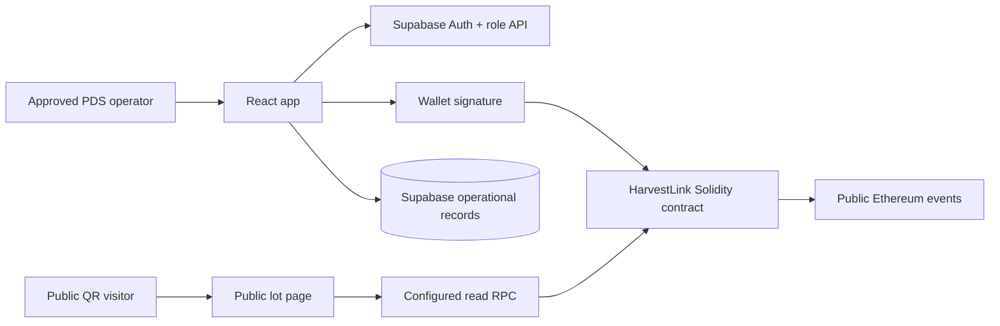

# HarvestLink: Ethereum PDS and food supply tracking

HarvestLink records food lot registration, custody, stock receipt, allocation, and final distribution as transactions on a public EVM chain. Supabase provides account authentication and stores operational details; it is not treated as proof of chain activity. Public lot pages read Ethereum state and transaction events. Beneficiary identity and eligibility details must remain private and off chain.

## Runtime flow

## Local setup

1. Install dependencies: `npm install`.
2. Copy `.env.example` to `.env`. Set the Vite Supabase variables expected by `src/integrations/supabase/client.ts`, and set `VITE_CHAIN_ID`, `VITE_CONTRACT_ADDRESS`, `VITE_RPC_URL`, `VITE_EXPLORER_URL`, `VITE_DEPLOYMENT_BLOCK`, and `VITE_PUBLIC_BASE_URL` after deployment.
3. Compile and sync the Solidity artifact: `npm run chain:compile`.
4. For a new test deployment, configure `DEPLOY_RPC_URL` and `DEPLOYER_PRIVATE_KEY`; optional `BOOTSTRAP_*_WALLETS` values grant operational roles. Run `npm run chain:deploy`. The script writes `deployments/<chainId>.json`; copy the deployment address, chain ID, and block into the frontend and Supabase configuration.
5. Apply the migrations in `supabase/migrations/` to the configured Supabase project and deploy the functions under `supabase/functions/`.
6. Set Edge Function secrets: `ETHEREUM_RPC_URL`, `ETHEREUM_CHAIN_ID`, `ETHEREUM_CONFIRMATIONS`, `HARVESTLINK_CONTRACT_ADDRESS`, `ETHEREUM_EXPLORER_URL`, and `PUBLIC_APP_URL`. These are server-side secrets/configuration, never `VITE_` variables.
7. Start the UI with `npm run dev`.

New accounts have consumer access while their requested operational role awaits admin approval. Supabase role approval and the corresponding on-chain wallet role are separate steps. Contract administration should use a governed admin wallet, ideally a multisig for a real deployment. Never place a privileged private key in frontend configuration.

## Implemented source workflows

- Crop/lot registration binds a verified wallet to the authenticated account, submits a wallet-signed Ethereum transaction, waits for confirmations, and independently checks the event before showing success.
- Authorized operators can transfer custody, split lots, receive stock, allocate stock, issue a secret-backed entitlement, and record one-time distribution.
- Public `/lot/:lotId` reads chain state and event history; QR verification rechecks Ethereum receipt and the canonical record commitment.
- Contract roles, pause control, replay checks, lot recall, and role approval paths are included in source.

The retailer dashboard still contains demonstration inventory and forecast data; use `/pds` for on-chain operations. The entitlement secret must be delivered privately and securely by the operator. Eligibility is not proven by the contract, and this prototype does not provide a zero-knowledge eligibility system.

## Deployment and completion status

The source includes a compile/deploy workflow, but this repository does not establish that a contract has been deployed, that Supabase migrations/functions have been applied, or that a pilot is operating. Do not describe the system as deployed or production-ready until those external steps are completed. Production also requires contract security review, operational key governance, indexing/reorg recovery, monitoring, and a field-validated privacy and dispute process. Core source workflows are implemented; deployment and production assurance remain outstanding.
