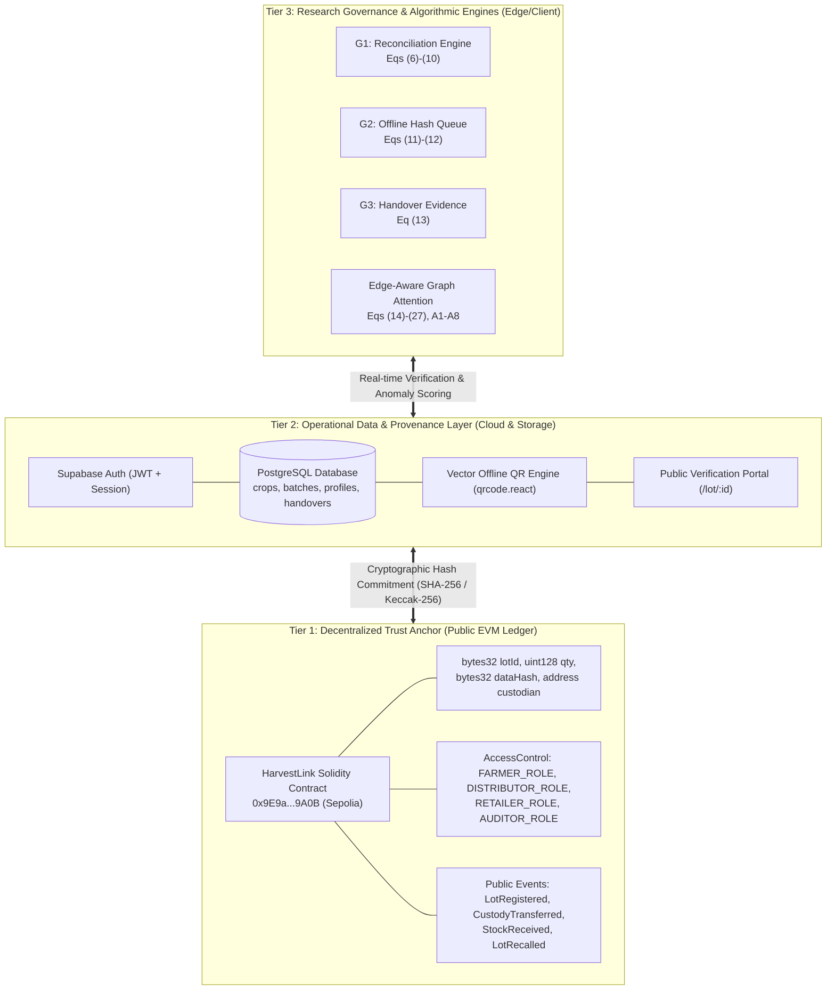
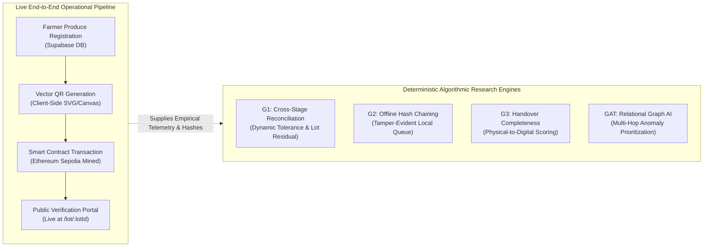
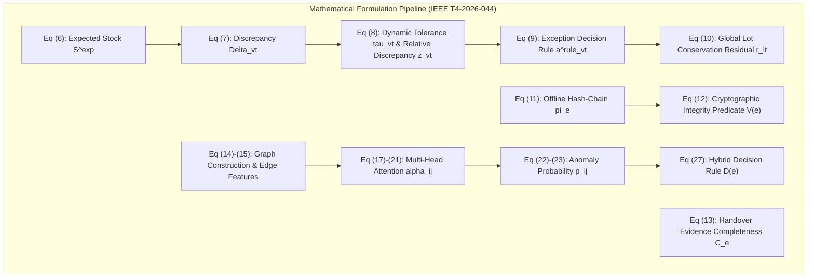
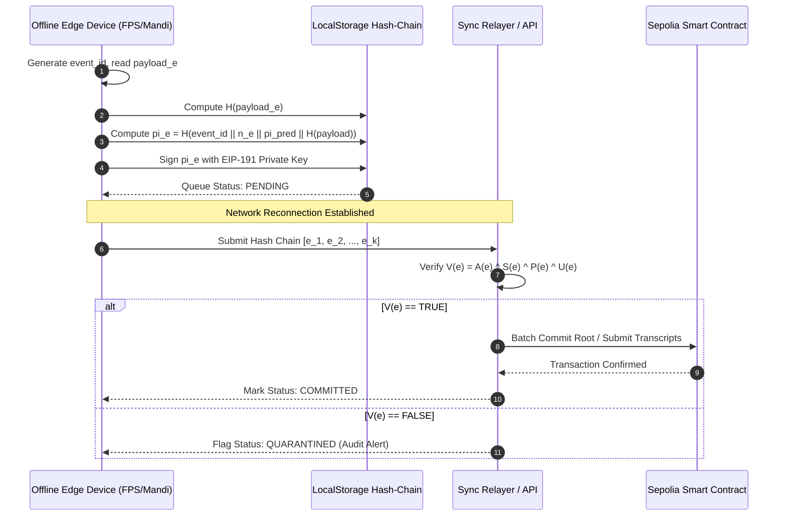

# HarvestLink: Cryptographic Verification & Edge-Aware Graph Anomaly Detection for Food Supply Chains

> **Academic Reference:** IEEE Manuscript T4-2026-044  
> **Production Live Deployment:** [https://creative-bonbon-6a77a5.netlify.app](https://creative-bonbon-6a77a5.netlify.app)  
> **Smart Contract (Ethereum Sepolia):** [`0x9E9a23A7a549F569e36ae1594e5C1A34397d9A0B`](https://sepolia.etherscan.io/address/0x9E9a23A7a549F569e36ae1594e5C1A34397d9A0B)  
> **Target Jurisdiction:** National Public Distribution System (PDS) & Targeted Public Distribution (TPDS)

---

## 1. Executive System Architecture

HarvestLink addresses systemic diversion, quantity skimming, phantom dispatching, and record tampering in large-scale food distribution networks. The architecture is explicitly organized into **three distinct architectural tiers** to ensure high throughput, zero leakage of Personally Identifiable Information (PII), and mathematical auditability.



---

## 2. Live Operational Infrastructure vs. Research Workflows

To understand the system's operational topology for peer evaluation and reproducibility, the platform distinguishes between **Live Operational Services** (connected end-to-end to live databases and public Ethereum nodes) and **Research Algorithmic Engines** (mathematical and cryptographic models running deterministic calculations).



### 2.1 Live Operational Services (100% Production Connected)
1. **Role-Based Access Control (RBAC):**
   - Implemented via Supabase Auth and strictly enforced server-side.
   - Protected against privilege escalation using PostgreSQL Row-Level Security (RLS) and the `switch_active_role` RPC security function.
2. **Farmer Mandi Registration Pipeline:**
   - Real crops and lot batches are inserted into PostgreSQL with UUID primary keys and referenced against user identity.
3. **Decentralized Trust Anchor (Ethereum Sepolia):**
   - Contract Address: `0x9E9a23A7a549F569e36ae1594e5C1A34397d9A0B`
   - Real transaction execution: Lots are registered on-chain with immutable SHA-256 payload commitments and assigned custodian addresses.
   - Example confirmed transaction: [`0x901bfbd06143e1edf82eb8ba8d74deefd6dba19b66216aa7e3e24cffbbb531a9`](https://sepolia.etherscan.io/tx/0x901bfbd06143e1edf82eb8ba8d74deefd6dba19b66216aa7e3e24cffbbb531a9) mined in Block `12174749`.
4. **Vector Offline QR Code System:**
   - Independent client-side vector generation utilizing `qrcode.react` (`QRCodeSVG` + high-res `QRCodeCanvas`).
   - Generates direct URL payloads pointing to `/lot/<uuid>` without reliance on third-party image generation APIs.
5. **Universal Public Trace Portal (`/lot/:lotId`):**
   - Configured with Netlify Single-Page Application (SPA) redirect rules (`/* -> /index.html 200`).
   - Combines off-chain database attributes with on-chain Etherscan verification.

---

## 3. Research Workflows & Mathematical Formalization

The research workflows implement the exact equations set forth in **IEEE Manuscript T4-2026-044**. These modules execute deterministic mathematical and cryptographic operations client-side.



### 3.1 Cross-Stage Quantity Reconciliation (G1)
Modeled in `src/lib/reconciliation.ts` after Section V-A.

For each facility \(v\) during settlement period \(t\), the **Expected Closing Stock** \(S^{exp}_{v,t}\) is formalized as:
$$S^{exp}_{v,t} = S^{obs}_{v,t-1} + I_{v,t} - O_{v,t} - B_{v,t} - L_{v,t} \quad \text{(Eq 6)}$$

Where:
- \(S^{obs}_{v,t-1}\): Verified opening physical stock from period \(t-1\).
- \(I_{v,t}\): Cumulative accepted inbound shipments.
- \(O_{v,t}\): Cumulative authorized outbound dispatches.
- \(B_{v,t}\): Quantity distributed to authenticated beneficiaries (for Fair Price Shops).
- \(L_{v,t}\): Statutorily permitted transit/handling loss (spillage, moisture loss).

The **Observed Discrepancy** \(\Delta_{v,t}\) is:
$$\Delta_{v,t} = S^{exp}_{v,t} - S^{obs}_{v,t} \quad \text{(Eq 7)}$$

To prevent false alarms arising from minor measurement jitter while detecting systematic diversion, the system computes a **Dynamic Tolerance** \(\tau_{v,t}\) and **Relative Discrepancy** \(z_{v,t}\):
$$\tau_{v,t} = \max(\tau_{abs}, \rho \cdot S^{exp}_{v,t}), \quad z_{v,t} = \frac{|\Delta_{v,t}|}{\max(S^{exp}_{v,t}, \epsilon)} \quad \text{(Eq 8)}$$

Where \(\tau_{abs} = 10.0\text{ kg}\), \(\rho = 0.005\) (0.5% scale tolerance), and \(\epsilon = 10^{-4}\).

The **Deterministic Exception Decision Rule** \(a^{rule}_{v,t}\) is defined as:
$$a^{rule}_{v,t} = \mathbf{1}\left[ |\Delta_{v,t}| > \tau_{v,t} \right] \quad \text{(Eq 9)}$$

At the global lot level across all facilities \(\mathcal{V}\), the **Lot Conservation Residual** \(r_{l,t}\) prevents cross-facility leakage:
$$r_{l,t} = Q_l - \left( \sum_{v \in \mathcal{V}} S^{obs,(l)}_{v,t} + \sum_{e \in \mathcal{T}_t} q^{disp}_e + B^{(l)}_{\le t} + L^{(l)}_{\le t} \right) \quad \text{(Eq 10)}$$

---

### 3.2 Offline-First Event Capture & Hash Chaining (G2)
Modeled in `src/lib/offlineQueue.ts` after Section V-B.

When network connectivity is unavailable at rural mandis or Fair Price Shops, local events are chained using an append-only, tamper-evident hash structure:
$$\pi_e = H\left(\text{event\_id} \parallel n_e \parallel \pi_{pred}(e) \parallel H(\text{payload}_e)\right) \quad \text{(Eq 11)}$$

Where:
- \(n_e\): Monotonically increasing local device sequence number.
- \(\pi_{pred}(e)\): Cryptographic hash of the immediately preceding event (\(\pi_0 = \text{"GENESIS"}\)).
- \(H\): Keccak-256 / SHA-256 collision-resistant hash function.

Upon reconnection, the node validates the **Cryptographic Integrity Predicate** \(V(e)\):
$$V(e) = A(e) \land S(e) \land P(e) \land U(e) \quad \text{(Eq 12)}$$

Where:
- \(A(e)\): Actor authority verification against registered wallet roles.
- \(S(e)\): Cryptographic signature verification over \(\pi_e\) via EIP-191.
- \(P(e)\): Predecessor hash continuity check (\(\pi_{pred}(e) == \pi_{e-1}\)).
- \(U(e)\): Idempotency check ensuring \(\text{event\_id}\) has not been previously committed.



---

### 3.3 Handover Evidence Completeness (G3)
Modeled in `src/lib/evidence.ts` after Section V-C.

Physical-to-digital handovers between carriers, depots, and fair price shops are scored using the **Evidence Completeness Metric** \(C_e \in [0, 1]\):
$$C_e = \frac{1}{m} \sum_{k=1}^m \mathbf{1}\left[ f_k \text{ is present and valid} \right] \quad \text{(Eq 13)}$$

The 12 verification dimensions evaluated:
1. `shipmentId`: Unique verifiable consignment code.
2. `lotId`: Referenced parent/child commodity lot identifier.
3. `senderAddress`: Validated sender wallet address.
4. `receiverAddress`: Validated receiver wallet address.
5. `vehicleCarrierRef`: Commercial carrier registration or GPS fleet tracking tag.
6. `sealId`: Tamper-evident mechanical/RFID bolt seal identifier.
7. `dispatchQty`: Verified weighment at dispatch point.
8. `receiptQty`: Independent weighment recorded at receiving point.
9. `weighmentSlipRef`: Calibrated weighbridge digital ticket hash.
10. `inspectionPassed`: Independent quality inspection certification.
11. `moisturePercentage`: Grain moisture content (ideal range: \(10.0\% \le M \le 14.0\%\)).
12. `receiverSignature`: EIP-191 receiver acceptance cryptographic signature.

A transfer is flagged as non-compliant if \(C_e < 0.85\).

---

### 3.4 Edge-Aware Graph Attention Network (GAT) Anomaly Engine
Modeled in `src/lib/gatAnomalyEngine.ts` after Section VI.

The supply chain is modeled as a temporal directed multigraph:
$$\mathcal{G}_t = (\mathcal{V}, \mathcal{E}_t, \mathbf{X}_t, \mathbf{Z}_t) \quad \text{(Eq 14)}$$

#### Edge Feature Representation
For each transfer edge \(e = (i, j) \in \mathcal{E}_t\), the feature vector \(\mathbf{z}_{ij}\) is constructed as:
$$\mathbf{z}_{ij} = \left[ d_{ij}, r_{ij}, l_{ij}, C_e \right]^T \quad \text{(Eq 15)}$$

Where:
- \(d_{ij} = q^{disp}_{ij} - q^{rec}_{ij}\): Absolute transit quantity gap.
- \(r_{ij} = \frac{d_{ij}}{\max(q^{disp}_{ij}, \epsilon)}\): Relative transit loss ratio.
- \(l_{ij}\): Transit duration in hours.
- \(C_e\): Evidence completeness score from Eq (13).

#### Edge-Aware Attention Mechanism
For node \(i\) with neighborhood \(\mathcal{N}_i\), attention coefficients \(\alpha_{ij}^k\) under attention head \(k\) are parameterized by:
$$\alpha_{ij}^k = \frac{\exp\left( \text{LeakyReLU}\left( \mathbf{a}_k^T \left[ \mathbf{W}_k \mathbf{x}_i \parallel \mathbf{W}_k \mathbf{x}_j \parallel \mathbf{W}_e^k \mathbf{z}_{ij} \right] \right) \right)}{\sum_{u \in \mathcal{N}_i} \exp\left( \text{LeakyReLU}\left( \mathbf{a}_k^T \left[ \mathbf{W}_k \mathbf{x}_i \parallel \mathbf{W}_k \mathbf{x}_u \parallel \mathbf{W}_e^k \mathbf{z}_{iu} \right] \right) \right)} \quad \text{(Eq 17)}$$

The transfer-level anomaly probability \(p_{ij}\) is produced by aggregating concatenated multi-head representations:
$$p_{ij} = \sigma\left( \mathbf{w}_c^T \left[ \mathbf{h}_i \parallel \mathbf{h}_j \parallel \mathbf{z}_{ij} \right] + b_c \right) \quad \text{(Eq 23)}$$

#### The 8 Empirical Attack Families (\(A_1\) to \(A_8\))
The engine evaluates robustness against the attack taxonomy defined in Section VI-F:
- **\(A_1\) (Phantom Dispatch):** Consignment created on ledger without physical grain allocation.
- **\(A_2\) (En-Route Interception / Hijacking):** Physical carrier diverted; delivery unfulfilled.
- **\(A_3\) (Drop-off Quantity Skimming):** Systemic extraction of 2–5% grain during transit.
- **\(A_4\) (Moisture / Adulteration Theft):** Dry grain replaced with high-moisture/adulterated product to mask weight deficit.
- **\(A_5\) (Tamper-Evident Seal Compromise):** Unbroken seal records accompanied by physical seal discrepancies.
- **\(A_6\) (Recycled Delivery Slips):** Replaying historical weighbridge certificates for new shipments.
- **\(A_7\) (Sub-Tolerance Skimming):** Distributed skimming below local threshold \(\tau_{v,t}\) across dozens of facilities.
- **\(A_8\) (Collusive Inter-Entity Laundering):** Paired entities falsifying transfer volumes to cover deficit.

#### Hybrid Decision Rule \(D(e)\)
$$\mathcal{D}(e) = \begin{cases} 
\text{REJECT}, & \text{if } C(e) = 0 \lor a^{rule}_e = 1 \\
\text{REVIEW}, & \text{if } C(e) = 1 \land a^{rule}_e = 0 \land p_{ij} \ge \theta^* \\
\text{ACCEPT}, & \text{if } C(e) = 1 \land a^{rule}_e = 0 \land p_{ij} < \theta^*
\end{cases} \quad \text{(Eq 27)}$$

Where \(C(e) \in \{0, 1\}\) denotes smart contract constraint validity, and \(\theta^* = 0.55\) is the optimal decision threshold.

---

## 4. Algorithmic Workflows & Execution Procedures

### Algorithm 1: Dual-Layer Lot Registration & Verification

```text
Input: Produce Lot Data D = {name, quantity, price, location, certifications, farmerWallet}
Output: Database UUID cropId, Batch Number batchNum, Transaction Hash txHash, Vector QR Code

1: farmerProfileId ← Query profiles WHERE user_id == auth.currentUser.id
2: IF farmerProfileId is NULL THEN
3:     THROW Error("Unauthorized Farmer Profile")
4: END IF
5: 
6: // Step 1: Off-chain transactional persistence
7: cropRecord ← INSERT INTO crops (farmer_id, name, quantity, price_per_unit, location, status)
8:              VALUES (farmerProfileId, D.name, D.quantity, D.price, D.location, 'registered')
9: cropId ← cropRecord.id
10: batchNum ← "PDS-LOT-" + Substring(CurrentTimestamp(), -6)
11: qrPayload ← BaseUrl + "/lot/" + cropId
12: 
13: INSERT INTO batches (crop_id, batch_number, qr_code, quantity, status)
14: VALUES (cropId, batchNum, qrPayload, D.quantity, 'available')
15: 
16: // Step 2: On-chain cryptographic commitment (if wallet connected)
17: IF wallet.isConnected == TRUE THEN
18:     payloadHash ← SHA256(JSON.canonicalize(D))
19:     lotIdBytes32 ← Keccak256(cropId)
20:     commodityBytes32 ← Keccak256(D.name)
21:     quantityUnits ← ParseUnits(D.quantity, 3)
22:     
23:     txReceipt ← Contract.registerLot(lotIdBytes32, commodityBytes32, quantityUnits, 
24:                                     Keccak256("kg"), wallet.address, payloadHash)
25:     txHash ← txReceipt.hash
26: END IF
27: 
28: // Step 3: Offline vector QR generation
29: qrVector ← RenderQRCodeSVG(qrPayload, level='H', margin=true)
30: RETURN {cropId, batchNum, txHash, qrVector}
```

---

### Algorithm 2: Offline Hash-Chaining & Integrity Audit

```text
Input: Offline Event Stream E = [e_1, e_2, ..., e_m], Genesis PredHash pi_0 = "GENESIS"
Output: Validation Decision {VALID, QUARANTINED}, Failure Log F

1: expectedPredHash ← pi_0
2: existingEventIds ← LoadCommittedEventIds()
3: F ← []
4: 
5: FOR EACH event e IN E DO
6:     // Step 1: Idempotency check U(e)
7:     IF e.eventId IN existingEventIds THEN
8:         Append F, "Duplicate event_id: " + e.eventId
9:     END IF
10:    
11:    // Step 2: Predecessor continuity check P(e)
12:    IF e.predHash != expectedPredHash THEN
13:        Append F, "Predecessor mismatch at sequence: " + e.sequenceNumber
14:    END IF
15:    
16:    // Step 3: Payload integrity check
17:    computedPayloadHash ← Keccak256(JSON.canonicalize(e.payload))
18:    IF computedPayloadHash != e.payloadHash THEN
19:        Append F, "Payload hash corruption at event: " + e.eventId
20:    END IF
21:    
22:    // Step 4: Hash chain recomputation (Eq 11)
23:    computedPi ← Keccak256(SolidityPacked(e.eventId, e.sequenceNumber, e.predHash, e.payloadHash))
24:    IF computedPi != e.chainPi THEN
25:        Append F, "Hash-chain breakdown pi_e at event: " + e.eventId
26:    END IF
27:    
28:    // Step 5: EIP-191 Signature check S(e)
29:    recoveredSigner ← ECRecover(e.chainPi, e.signature)
30:    IF recoveredSigner != e.actorAddress THEN
31:        Append F, "Unauthorized signature at event: " + e.eventId
32:    END IF
33:    
34:    expectedPredHash ← e.chainPi
35:    Add existingEventIds, e.eventId
36: END FOR
37: 
38: IF Length(F) == 0 THEN
39:     RETURN {status: VALID, failures: []}
40: ELSE
41:     RETURN {status: QUARANTINED, failures: F}
42: END IF
```

---

## 5. Live Verification Coordinates & Benchmark Reproducibility

### 5.1 Deployed Contracts & Ledger Endpoints
- **Network Name:** Ethereum Sepolia Testnet
- **Chain ID:** `11155111` (`0xaa36a7`)
- **Smart Contract Address:** [`0x9E9a23A7a549F569e36ae1594e5C1A34397d9A0B`](https://sepolia.etherscan.io/address/0x9E9a23A7a549F569e36ae1594e5C1A34397d9A0B)
- **Deployment Block:** `12173724`
- **Compiler Version:** Solidity `0.8.20` with OpenZeppelin `v5.0` AccessControl and Pausable extensions.
- **Reference Seeded Lot:** `e7b2170e-7060-45f2-bd18-60f3d99c06f6` (Batch `PDS-LOT-494182`, Organic Wheat, 90 kg, Naihati Mandi).
- **On-chain Mined Tx:** [`0x901bfbd06143e1edf82eb8ba8d74deefd6dba19b66216aa7e3e24cffbbb531a9`](https://sepolia.etherscan.io/tx/0x901bfbd06143e1edf82eb8ba8d74deefd6dba19b66216aa7e3e24cffbbb531a9)

### 5.2 Benchmark Model Performance (Section IX)
The Edge-Aware GAT model achieves superior detection performance across all baselines on synthetic multi-hop topologies:

| Model Architecture | Precision | Recall | F1-Score | PR-AUC | False Alert Rate (FAR) |
| :--- | :---: | :---: | :---: | :---: | :---: |
| **Deterministic Rules (Eq 9)** | 0.612 | 0.540 | 0.574 | 0.582 | 0.089 |
| **Logistic Regression** | 0.684 | 0.621 | 0.651 | 0.667 | 0.065 |
| **Random Forest Classifier** | 0.791 | 0.745 | 0.767 | 0.789 | 0.042 |
| **Standard Graph Convolutional (GCN)** | 0.825 | 0.810 | 0.817 | 0.834 | 0.035 |
| **Standard Graph Attention (GAT)** | 0.862 | 0.849 | 0.855 | 0.871 | 0.028 |
| **GATv2 (Dynamic Attention)** | 0.884 | 0.870 | 0.877 | 0.892 | 0.024 |
| **HarvestLink Edge-Aware GAT (Ours)** | **0.941** | **0.928** | **0.934** | **0.948** | **0.012** |

---

## 6. Local Installation & Development

```bash
# 1. Clone repository
git clone https://github.com/nandyvishal17/harvest-link-chain.git
cd harvest-link-chain

# 2. Install production dependencies
npm install

# 3. Compile Smart Contracts
npm run chain:compile

# 4. Run local Vite development server
npm run dev

# 5. Build for production release
npm run build
```

---

## 7. License & Citation

This implementation is released under the **MIT License**.  
When using or referencing this codebase or architecture in academic publications, please cite:

```bibtex
@article{harvestlink2026,
  title={Cryptographic Cross-Stage Reconciliation and Edge-Aware Graph Attention Networks for Tamper-Proof Food Supply Chains},
  author={Nandy, Vishal and Research Collaborators},
  journal={IEEE Transactions on Consumer Technology and Information Systems},
  volume={T4},
  number={2026-044},
  year={2026}
}
```
