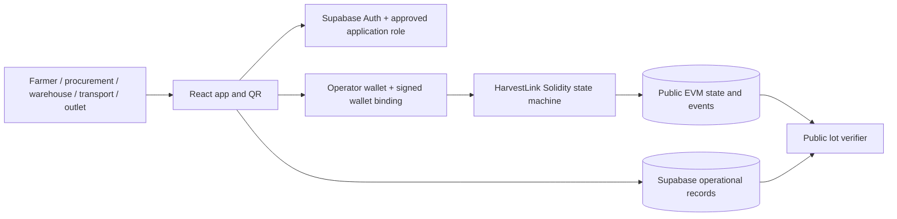
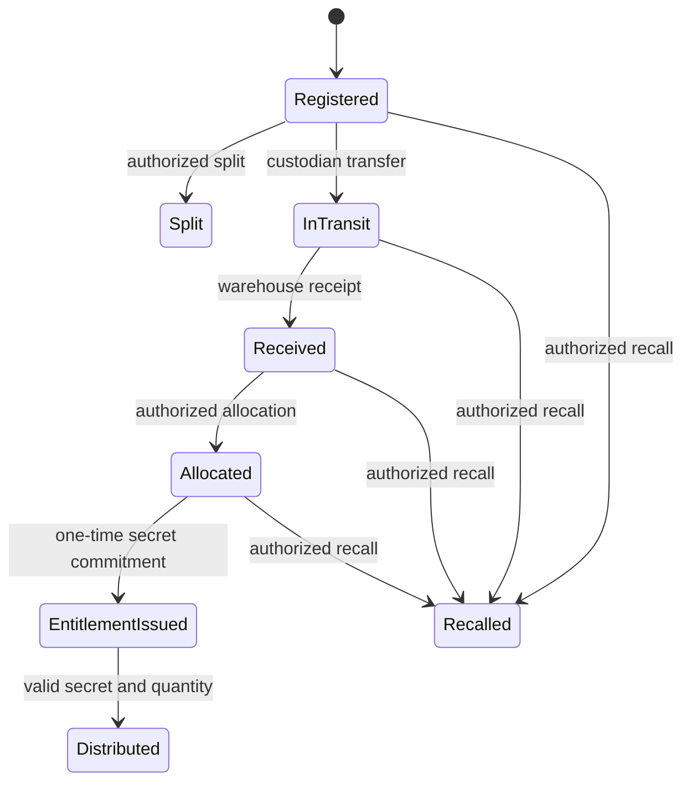

# Open Ethereum PDS and food traceability design

## Design principles

HarvestLink publishes an auditable commodity journey from lot registration through custody, storage receipt, allocation, and final distribution. Contract state and emitted events record operator-signed claims; they do not independently prove physical-world facts. Operators, inspection evidence, governance, and dispute processes remain essential.

Public Ethereum is permanent. Keep beneficiary identity, eligibility documents, phone numbers, addresses, household details, and other personal data off chain. Use commitments over public-safe, versioned data only. A digest of predictable or sensitive data is not private.

## End-to-end architecture

## State transitions

The contract enforces caller roles, custody/lot state, quantity bounds, and single-use redemption. Application roles and contract wallet roles are distinct controls: approval in Supabase does not automatically grant an Ethereum role. Contract administration should be governed by a multisig for real deployments.

## Transaction sequence

1. User signs in and requests an organizational role.
2. Admin approves the application role and separately grants the connected wallet's contract role.
3. Wallet proof binds the Ethereum address to the authenticated account.
4. The app validates public-safe fields and creates a versioned commitment.
5. Wallet signs a contract transaction; contract checks authorization and state, then emits an event.
6. The app waits for confirmations. Registration confirmation Edge Function independently checks chain ID, configured contract, transaction sender, event arguments, and recomputed record commitment.
7. Public QR pages display the contract-backed lot state and event history with transaction links.

### Current transaction lifecycle

The source handles submitted writes and confirmation for crop registration. It does not yet provide a durable outbox or background recovery for a database write followed by a failed chain write. Other PDS actions submit directly through the wallet and await a transaction. Reorg recovery is not implemented, so production status must be reconciled independently before claiming finality.

## Toolchain and configuration

- Solidity is compiled with pinned `solc` using installed OpenZeppelin sources via `npm run chain:compile`.
- The generated contract artifact is written under `artifacts/`, and `src/contracts/HarvestLink.json` is synced for the app.
- `npm run chain:deploy` deploys to the configured RPC using `DEPLOYER_PRIVATE_KEY`, then writes network/address/block details under `deployments/` and optionally grants bootstrap roles.
- Frontend configuration uses `VITE_CHAIN_ID`, `VITE_CONTRACT_ADDRESS`, `VITE_RPC_URL`, `VITE_EXPLORER_URL`, `VITE_DEPLOYMENT_BLOCK`, and `VITE_PUBLIC_BASE_URL`.
- Edge Functions require `ETHEREUM_RPC_URL`, `ETHEREUM_CHAIN_ID`, `ETHEREUM_CONFIRMATIONS`, `HARVESTLINK_CONTRACT_ADDRESS`, `ETHEREUM_EXPLORER_URL`, and `PUBLIC_APP_URL`.
- Deployment keys and Supabase service credentials must remain server-side; never use a `VITE_` prefix for secrets.

## What remains before production

- Deploy a matching contract to an agreed test network and configure the resulting chain ID/address in frontend and Edge Functions.
- Apply Supabase migrations and deploy/validate Edge Functions in the actual project.
- Add durable idempotent transaction outbox, retry/reconciliation worker, and reorg-aware confirmation tracking.
- Add a production event indexer with pagination and monitoring; current UI queries RPC directly.
- Define an eligibility proof and confidential entitlement delivery/recovery process with a privacy threat model. Current secret-backed redemption is not a zero-knowledge proof.
- Review contract economics, authorization, emergency governance, correction/dispute semantics, data retention, offline operations, and accessibility with stakeholders.
- Complete automated security/integration coverage, independent contract audit, operational monitoring/runbooks, and an accepted field pilot.

## Acceptance conditions

- Every claim labeled chain-confirmed identifies chain, contract, transaction, event, and confirmation status.
- Invalid roles, state transitions, quantity overdraw, and duplicate redemption are rejected by Solidity.
- Public verification recomputes the record commitment from public-safe data and checks contract events.
- No personal or sensitive beneficiary information is published through events or public endpoints.
- Database/chain partial failure, duplicate submission, retry, and chain reorganization have tested recovery procedures.
- Deployed roles, keys, monitoring, incident response, and the field pilot are operationally accepted.

Until these conditions are met, describe HarvestLink as an implemented blockchain prototype awaiting deployment and production assurance, not as a live PDS service.
