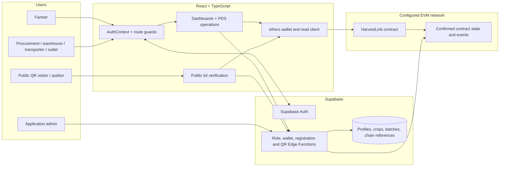
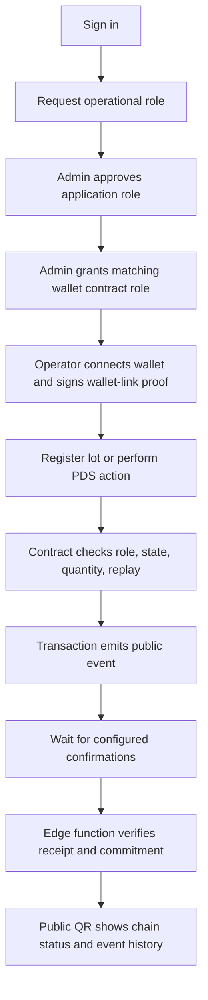

# HarvestLink system map and completion status

**Snapshot: 4 November 2026.** This describes the implementation present in the repository. It does not claim that an external Ethereum or Supabase deployment has been performed.

## System map

Supabase stores operational metadata and account roles. Ethereum is authoritative for the contract's lot state and accepted transitions. A database row, local digest, or submitted transaction is not presented as confirmed chain evidence.

## Core workflow

Crop registration additionally creates the crop/batch operational records in Supabase before chain submission. If the chain call or later confirmation fails, those records may remain pending; there is no durable outbox/reconciliation worker yet. Operators must not treat a pending record as verified.

## Repository responsibility map

| Path | Runtime responsibility |
|---|---|
| `src/App.tsx` | Route definitions for dashboards, `/pds`, QR details, and public `/lot/:lotId` |
| `src/contexts/AuthContext.tsx` | Supabase session and approved profile role |
| `src/pages/PDSOperations.tsx` | Wallet-driven PDS operations and role management UI |
| `src/pages/PDSLotDetails.tsx` | Public contract state and event history view |
| `src/hooks/useBlockchain.ts` | Registration workflow, wallet link, receipt confirmation and QR calls |
| `src/lib/blockchain.ts` | ethers wallet/RPC access, typed contract calls and event reads |
| `contracts/HarvestLink.sol` | Role-gated lot, custody, allocation and redemption state machine; legacy product/batch methods remain |
| `scripts/compile-contract.mjs` | Pinned solc compile against installed OpenZeppelin sources |
| `scripts/deploy-contract.mjs` | Deployment and initial role bootstrap from environment |
| `supabase/functions/` | Wallet proof, role requests, registration, chain confirmation, and public QR verification |
| `supabase/migrations/` | Chain reference fields, role approval and access policies |

## Implemented on-chain capabilities

- Register a lot with a public-safe commitment; split a lot into child lots.
- Transfer custody, record warehouse receipt, allocate quantities, and recall a lot.
- Issue a one-time secret-backed entitlement and record a replay-protected distribution.
- Pause controls, role-specific authorization, and app-side role approval plus wallet role grant/revoke.
- Wallet-signed crop registration, confirmation checks, public lot read, event history, and receipt/commitment QR verification.
- Reproducible local Solidity compilation, ABI sync, and environment-configured deployment script.

Contract events show that an address submitted a statement; they cannot establish that a physical delivery, weighing, quality inspection, or eligibility decision was truthful. Entitlement eligibility remains an off-chain responsibility. Never publish names, government IDs, phone numbers, household details, or predictable hashes of personal data.

## Remaining gaps and truthful completion status

| Area | Status |
|---|---|
| Solidity source and build/deploy scripts | Implemented in repository; compilation must be re-run against the checked-out state before release |
| Main PDS transitions | Implemented in contract and operator screen; requires deployed contract and role setup |
| Crop registration and public QR checks | Wired to transaction/receipt verification in source; requires deployed matching contract and Edge Functions |
| Ethereum deployment | Not evidenced; no deployed address/network is configured in tracked source |
| Supabase migration/function deployment | Not evidenced; deployment credentials/project state are external |
| Database/chain recovery | Incomplete: no transactional outbox, retry worker, or reorg reconciliation |
| Event indexing | Incomplete: public UI and verification query RPC logs directly; no production indexer/pagination service |
| PDS eligibility privacy | Partial: personal fields stay off-chain and entitlement uses a secret; no proof of eligibility or comprehensive threat-tested recovery flow |
| Legacy dashboards | Demo data remains, especially retailer inventory, payment labels, forecasts, and older product/batch views; these are not authoritative PDS records |
| Production assurance | Not complete: no evidence of contract audit, end-to-end deployment validation, monitoring, incident runbook, or accepted field pilot |

**Completion verdict:** core blockchain source functionality is implemented, but the project is not operationally complete or production-ready until deployment, recovery/indexing, security review, and pilot requirements are satisfied. Never claim live Ethereum verification until a matching deployment is configured and observed.
